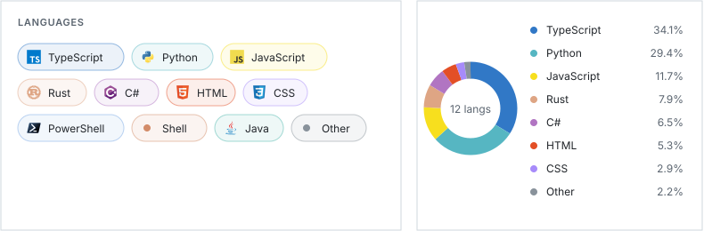
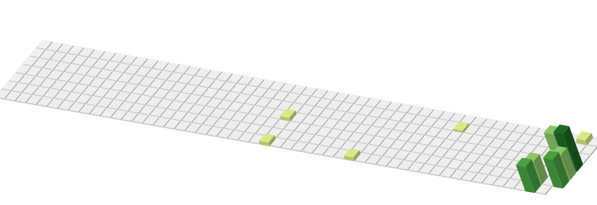

<picture>
  <source media="(prefers-color-scheme: dark)" srcset="./assets/terminal-intro-linux-v2-square.svg">
  
</picture>

<picture>
  <source media="(prefers-color-scheme: dark)" srcset="./assets/languages-837f7cb9bf9b.svg">
  
</picture>

### I've worked in these

<picture>
  <source media="(prefers-color-scheme: dark)" srcset="./assets/industries-v4-square.svg">
  
</picture>

### I studied here

<table width="100%">
<tr><td width="100%">
<picture>
  <source media="(prefers-color-scheme: dark)" srcset="./assets/education-compact.svg">
  
</picture>

&nbsp; Where I published this <a href="https://repositorio.ulisboa.pt/entities/publication/b7ac3551-13c5-4bac-a8d0-bfb867b42276"><strong>masters thesis</strong></a>, which helped in this <a href="https://www.frontiersin.org/journals/medicine/articles/10.3389/fmed.2025.1625897/full"><strong>research paper</strong></a>. &nbsp; 

</td></tr>
</table>

<picture>
  <source media="(prefers-color-scheme: dark)" srcset="./assets/contributions-dark-8438df5e5bcb.svg">
  
</picture>

<!-- pixel-experiment -->
<picture>
  <source media="(prefers-color-scheme: dark)" srcset="./assets/experiment-d3b318dde1cc.svg">
  
</picture>
<!-- /pixel-experiment -->
