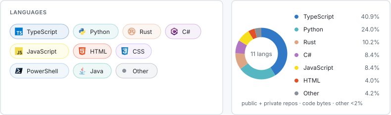

<picture>
  <source media="(prefers-color-scheme: dark)" srcset="./assets/terminal-intro.svg">
  
</picture>

<picture>
  <source media="(prefers-color-scheme: dark)" srcset="./assets/languages-526eeb1d2b9c.svg">
  
</picture>

### I've worked in these

<picture>
  <source media="(prefers-color-scheme: dark)" srcset="./assets/industries-v3.svg">
  
</picture>

### I studied this

<picture>
  <source media="(prefers-color-scheme: dark)" srcset="./assets/education.svg">
  
</picture>

I published [this](https://repositorio.ulisboa.pt/entities/publication/b7ac3551-13c5-4bac-a8d0-bfb867b42276) which helped in [this](https://www.frontiersin.org/journals/medicine/articles/10.3389/fmed.2025.1625897/full).

<picture>
  <source media="(prefers-color-scheme: dark)" srcset="./assets/contributions-dark-e0562cacb4d7.svg">
  
</picture>
