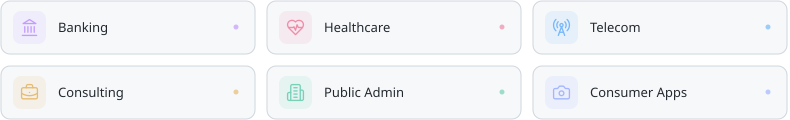

<picture>
  <source media="(prefers-color-scheme: dark)" srcset="./assets/terminal-intro.svg">
  
</picture>

<picture>
  <source media="(prefers-color-scheme: dark)" srcset="./assets/industries-v2.svg">
  
</picture>

<picture>
  <source media="(prefers-color-scheme: dark)" srcset="./assets/languages-526eeb1d2b9c.svg">
  
</picture>

<picture>
  <source media="(prefers-color-scheme: dark)" srcset="./assets/contributions-dark-e0562cacb4d7.svg">
  
</picture>
