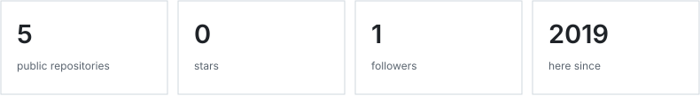

# i make stuff

some of it ends up here

### numbers

### stuff

| thing | what it does |
| :--- | :--- |
| [geodata dashboard](https://github.com/raullopesalves/geodata-dashboard-ui) | bird flu case data on maps and charts. |
| [expense tracker](https://github.com/raullopesalves/expense_tracker) | tracks expenses. |

### tools

TypeScript · React · Leaflet · Chart.js

[all repositories](https://github.com/raullopesalves?tab=repositories)
