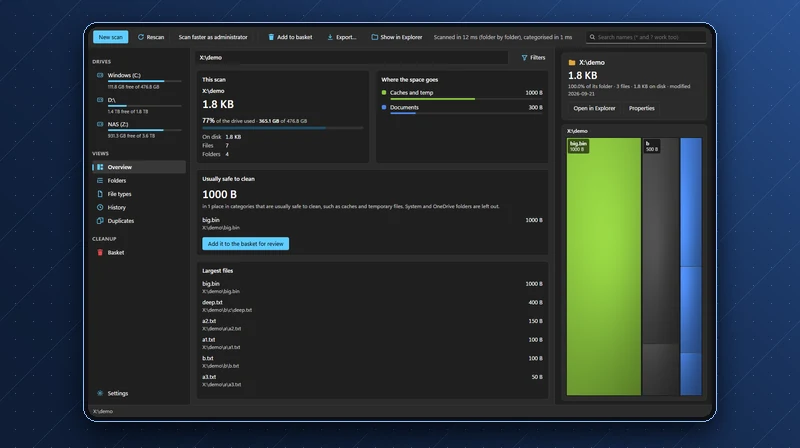
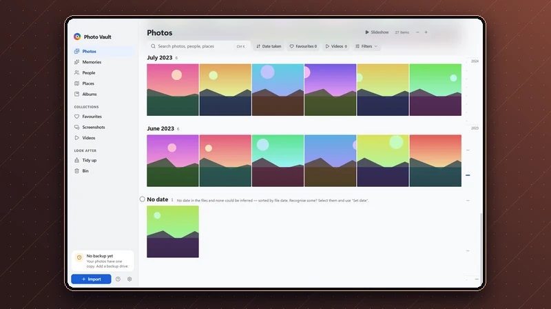
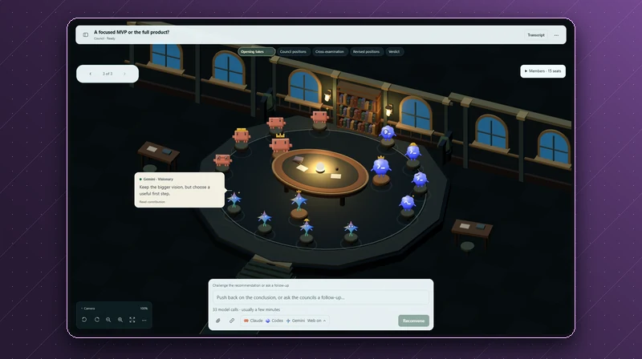
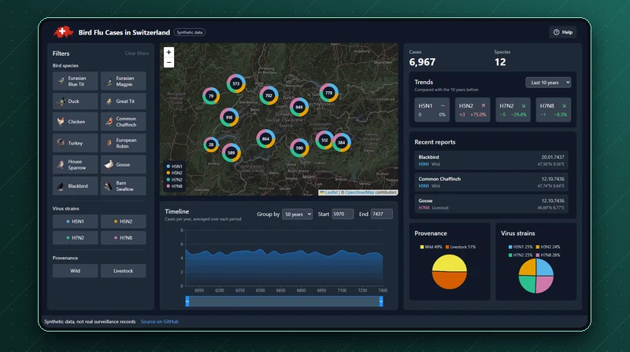
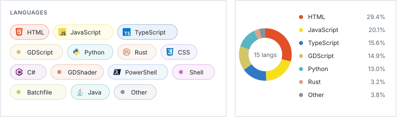
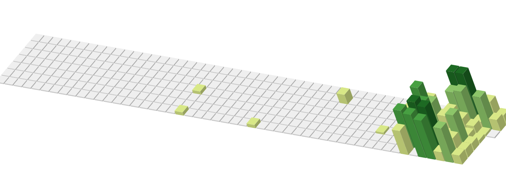

<picture>
  <source media="(prefers-color-scheme: dark)" srcset="./assets/terminal-intro-linux-v2-square.svg">
  
</picture>

### stuff i've made

<table width="100%">
<tr>
<td width="50%" valign="top">
  
  
<strong><a href="https://github.com/raullopesalves/bytescape">Bytescape</a></strong> Find what’s eating your disk space with a Windows app and CLI.

  
<strong><a href="https://github.com/raullopesalves/bytescape#see-the-workflow">Watch demo</a> ↗</strong> · <a href="https://github.com/raullopesalves/bytescape/releases/latest">Download</a> · <a href="https://github.com/raullopesalves/bytescape/blob/main/docs/CASE_STUDY.md">How it works</a>

</td>
<td width="50%" valign="top">
  
  
<strong><a href="https://github.com/raullopesalves/photovault">Photo Vault</a></strong> A photo archive that lives on your computer. Your files stay yours.

  
<strong><a href="https://github.com/raullopesalves/photovault#a-short-tour">See screenshots</a> ↗</strong> · <a href="https://github.com/raullopesalves/photovault/releases/latest">Download</a> · <a href="https://github.com/raullopesalves/photovault#my-contribution-and-technical-decisions">How it works</a>

</td>
</tr>
<tr>
<td width="50%" valign="top">
  
  
<strong><a href="https://github.com/raullopesalves/claude-codex-chat-public">Claude–Codex Chat</a></strong> Put Claude Code and Codex in a 3D room and let them debate.

  
<strong><a href="https://github.com/raullopesalves/claude-codex-chat-public#the-3d-council-room">Watch the Council</a> ↗</strong> · <a href="https://github.com/raullopesalves/claude-codex-chat-public/releases/tag/v1.1.0">Download</a>

</td>
<td width="50%" valign="top">
  
  
<strong><a href="https://github.com/raullopesalves/geodata-dashboard-ui">Geodata Dashboard</a></strong> Explore simulated bird flu reports on an interactive map of Switzerland.

  
<strong><a href="https://raullopesalves.github.io/geodata-dashboard-ui/">Open live demo</a> ↗</strong> · <a href="https://github.com/raullopesalves/geodata-dashboard-ui#how-it-works">How it works</a>

</td>
</tr>
</table>

<picture>
  <source media="(prefers-color-scheme: dark)" srcset="./assets/languages-38a58577240e.svg">
  
</picture>

### I've worked in these

<picture>
  <source media="(prefers-color-scheme: dark)" srcset="./assets/industries-v4-square.svg">
  
</picture>

### I studied here

<table width="100%">
<tr><td width="100%">
<picture>
  <source media="(prefers-color-scheme: dark)" srcset="./assets/education-compact.svg">
  
</picture>

&nbsp; Where I published this <a href="https://repositorio.ulisboa.pt/entities/publication/b7ac3551-13c5-4bac-a8d0-bfb867b42276"><strong>masters thesis</strong></a>, which helped in this <a href="https://www.frontiersin.org/journals/medicine/articles/10.3389/fmed.2025.1625897/full"><strong>research paper</strong></a>. &nbsp; 

</td></tr>
</table>

<picture>
  <source media="(prefers-color-scheme: dark)" srcset="./assets/contributions-dark-1c085fa347aa.svg">
  
</picture>

<!-- pixel-experiment -->
<picture>
  <source media="(prefers-color-scheme: dark)" srcset="./assets/experiment-fba74b210f95.svg">
  
</picture>
<!-- /pixel-experiment -->
