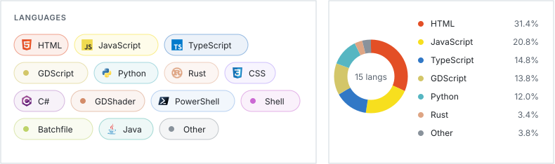
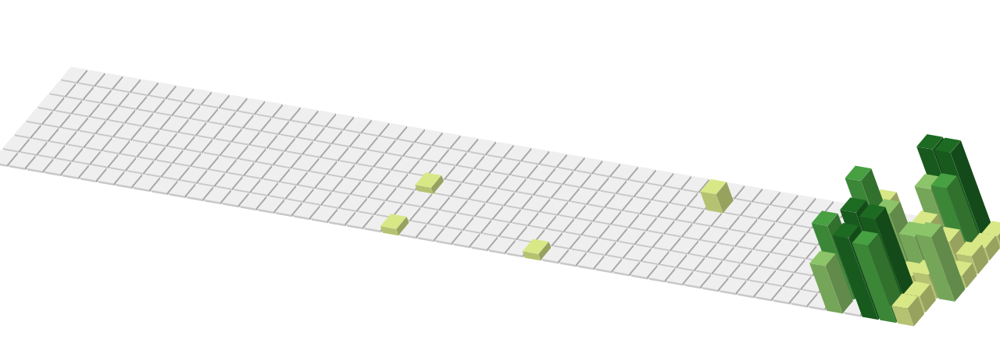

<picture>
  <source media="(prefers-color-scheme: dark)" srcset="./assets/terminal-intro-linux-v2-square.svg">
  
</picture>

### stuff i've made

**[Bytescape](https://github.com/raullopesalves/bytescape)**  
where did my disk space go. a windows app and cli to find out. rust + tauri.  
[download](https://github.com/raullopesalves/bytescape/releases/latest) · [demo](https://github.com/raullopesalves/bytescape#see-the-workflow) · [how it works](https://github.com/raullopesalves/bytescape/blob/main/docs/CASE_STUDY.md)

**[Photo Vault](https://github.com/raullopesalves/photovault)**  
a photo archive that lives on your computer. your files stay yours.  
[download](https://github.com/raullopesalves/photovault/releases/latest) · [screenshots](https://github.com/raullopesalves/photovault#a-short-tour) · [how it works](https://github.com/raullopesalves/photovault#my-contribution-and-technical-decisions)

<picture>
  <source media="(prefers-color-scheme: dark)" srcset="./assets/languages-fc614cc6aa8f.svg">
  
</picture>

### I've worked in these

<picture>
  <source media="(prefers-color-scheme: dark)" srcset="./assets/industries-v4-square.svg">
  
</picture>

### I studied here

<table width="100%">
<tr><td width="100%">
<picture>
  <source media="(prefers-color-scheme: dark)" srcset="./assets/education-compact.svg">
  
</picture>

&nbsp; Where I published this <a href="https://repositorio.ulisboa.pt/entities/publication/b7ac3551-13c5-4bac-a8d0-bfb867b42276"><strong>masters thesis</strong></a>, which helped in this <a href="https://www.frontiersin.org/journals/medicine/articles/10.3389/fmed.2025.1625897/full"><strong>research paper</strong></a>. &nbsp; 

</td></tr>
</table>

<picture>
  <source media="(prefers-color-scheme: dark)" srcset="./assets/contributions-dark-693c81435895.svg">
  
</picture>

<!-- pixel-experiment -->
<picture>
  <source media="(prefers-color-scheme: dark)" srcset="./assets/experiment-0105d3262251.svg">
  
</picture>
<!-- /pixel-experiment -->
