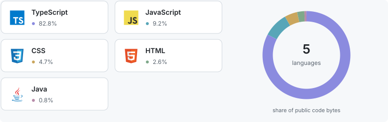

# i make stuff

some of it ends up here

### stuff

| thing | what it does |
| :--- | :--- |
| [geodata dashboard](https://github.com/raullopesalves/geodata-dashboard-ui) | bird flu case data on maps and charts. |
| [expense tracker](https://github.com/raullopesalves/expense_tracker) | tracks expenses. |

[all repositories](https://github.com/raullopesalves?tab=repositories)

### languages

### contributions

<picture>
  <source media="(prefers-color-scheme: dark)" srcset="./assets/contributions-dark-97ee20a0b3ac.svg">
  
</picture>
